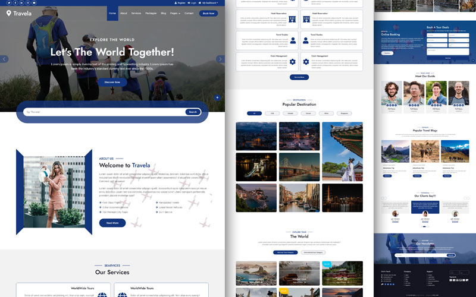

# 🌍 Travel Qila — Explore the World Together!

<p align="center">
  <strong>A modern, responsive tourism website designed to make discovering destinations and planning travel experiences more engaging.</strong>
</p>

<p align="center">
  
  
  
</p>

---

## 📸 Project Preview

<p align="center">
  
</p>

*Travel Qila brings destinations, travel packages and travel-related information together in one website experience.*

---

## ✨ About the Project

**Travel Qila** is a tourism and travel website project built to provide visitors with an engaging platform for exploring destinations, discovering travel packages and learning about travel services.

The website features a multi-page layout with dedicated sections for destinations, tours, packages, galleries, travel guides, blogs and booking enquiries.

The goal is to create a clean, accessible and visually appealing travel experience that makes it easier for visitors to explore their next journey.

## 🚀 Key Features

- **Modern Homepage:** A visually engaging landing page with a hero banner and destination-focused messaging.
- **About Us:** Dedicated page introducing the travel platform.
- **Travel Services:** A section showcasing available travel services.
- **Tour Packages:** Dedicated pages for exploring travel packages and tours.
- **Destinations:** A dedicated destination discovery experience.
- **Travel Blog:** Space for travel-related articles and updates.
- **Travel Guides:** Helpful travel information for visitors.
- **Gallery:** Visual presentation of travel experiences.
- **Booking Interface:** A dedicated booking page and booking calls to action.
- **Contact Page:** A dedicated point of contact for visitor enquiries.
- **Responsive Design:** Intended for a consistent experience across desktop, tablet and mobile screens.

*Note: The availability of backend-connected functionality depends on the implementation and integrations of the individual pages.*

## 🛠️ Technology Stack

| Technology | Purpose |
|---|---|
| HTML5 | Website structure and content |
| CSS3 | Styling and layout |
| JavaScript | Frontend interactions |
| SCSS | Maintainable stylesheet authoring |
| Assets (Images) | Visual content and website imagery |

## 📂 Project Structure

```text
Travel-Qila/
│
├── css/                         # Stylesheets
├── img/                         # Images and visual assets
├── js/                          # JavaScript files
├── lib/                         # Supporting libraries
├── scss/                        # SCSS source files
│
├── index.html                   # Homepage
├── about.html                   # About page
├── services.html                # Services page
├── packages.html                # Travel packages
├── destination.html             # Destinations
├── tour.html                    # Tour details
├── booking.html                 # Booking page
├── gallery.html                 # Travel gallery
├── blog.html                    # Blog page
├── guides.html                  # Travel guides
├── testimonial.html             # Testimonials
├── contact.html                 # Contact page
├── 404.html                     # Error page
│
├── README.md                    # Project documentation
├── LICENSE
└── .gitignore
```

## 💻 Getting Started

Follow these steps to run Travel Qila locally.

### 1. Clone the repository

```bash
git clone https://github.com/ImperialX1104/REPOSITORY-NAME.git
```

### 2. Navigate to the project directory

```bash
cd REPOSITORY-NAME
```

### 3. Open the website

You can open `index.html` directly in your browser.

Alternatively, use the **Live Server** extension in Visual Studio Code for a local development environment.

### 4. Start exploring

Navigate through the homepage and explore the individual website pages.

## ⚙️ Customization

You can customize the project to suit your requirements:

- Update website content and text in the HTML files.
- Replace images and visual assets inside the `img/` directory.
- Modify styling through the CSS files.
- Update interactive elements through the JavaScript files.
- Edit SCSS source files in the `scss/` directory.

## 🌐 Deployment

Travel Qila can be hosted using static website hosting services.

For GitHub Pages:

1. Open the repository on GitHub.
2. Navigate to **Settings → Pages**.
3. Select the deployment branch.
4. Choose the root directory.
5. Save the configuration.
6. Access the published website through the generated GitHub Pages URL.

Other hosting options include Netlify, Vercel and traditional web hosting providers.

## 🔮 Future Improvements

Potential enhancements for future versions include:

- Backend-powered booking management.
- User registration and authentication.
- Destination search and filtering.
- Integrated payment gateway.
- Dynamic travel package management.
- Admin dashboard for managing bookings and content.
- API integration for live travel information.
- Improved accessibility and performance optimization.

## 🤝 Contributing

Contributions, suggestions and improvements are welcome.

1. Fork the repository.
2. Create a feature branch.
3. Make your changes.
4. Commit your changes.
5. Push your branch.
6. Open a Pull Request.

## 📄 License

This project includes license files in the repository. Please refer to the applicable `LICENSE` file for the terms governing its use and distribution.

## 👨‍💻 Author

**Imperial Technologies**

GitHub: [@ImperialX1104](https://github.com/ImperialX1104)

---

<p align="center">
  <strong>Travel Qila — Let's Explore the World Together! 🌍</strong>
</p>

<p align="center">
  Made with ❤️ and a passion for technology and travel.
</p>
